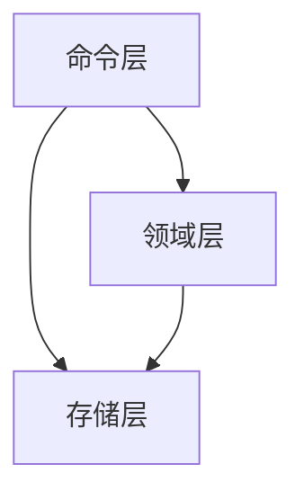
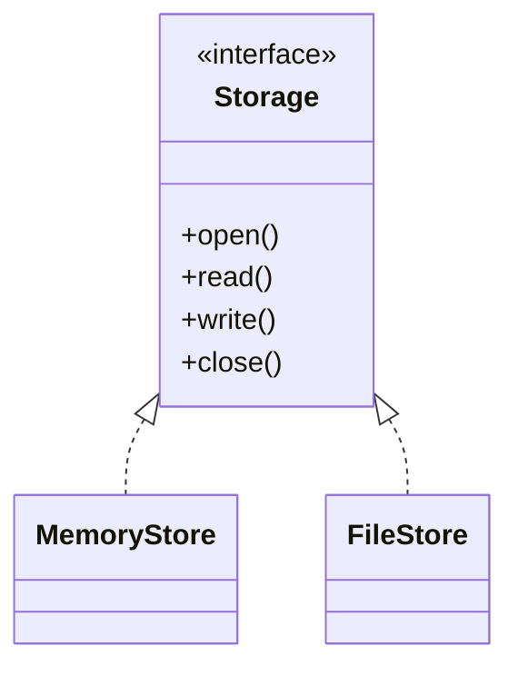
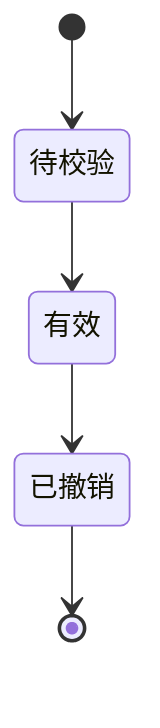
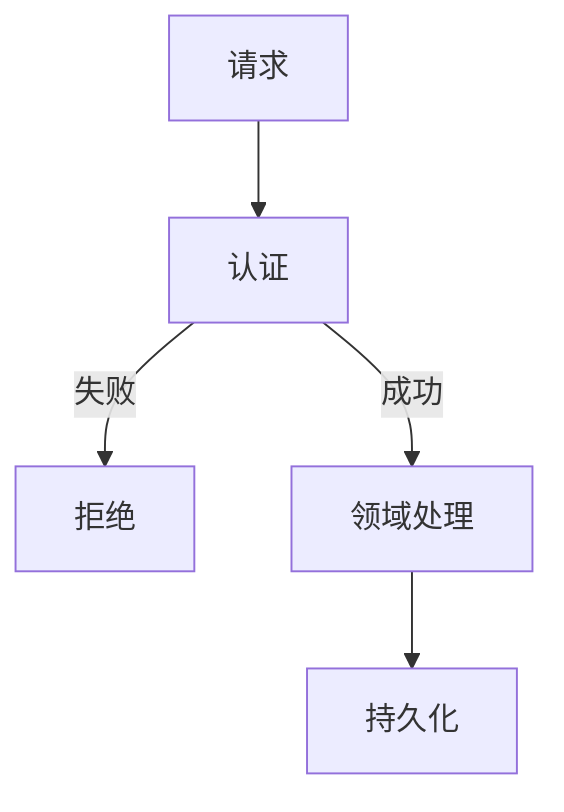

# 设计文档撰写技能

本技能规定 Arche 中每种对象的设计字段写什么、格式是什么。命令、qname、字段位置和 staging 见 `arche` 技能。

**模型映射**：Arche 没有独立文档树；下文中的设计字段就是对象字段。`DocumentTopic`、`DocumentList`、`DocumentCode`、`DocumentMermaid`、`DocumentHtml` 是 Arche 的字段对象，写入命令见 `arche` 技能。

## 1. 概念与术语

设计文档中的专业词汇必须有清晰定义。凡含义不显然、容易被不同读者理解成不同东西，或在不同文档中用法不一致的词，都要在概念空间中建立概念，并在文档中用概念引用指向它。

- 概念空间根是 `concept`，概念按目录组织：`concept/<domain|requirement|technical>/<概念>`；目录结构由智能体维护。
- Arche Concept 包含：
  - `name`：读者看到的术语，例如“智能体”；
  - `explanation`：这个术语是什么、边界和与其他概念的区别。
- 文档正文直接写术语名，并保证概念空间有对应 Concept；不要使用 v1 的 `[[concept:...]]` 语法。
- 第一次出现的关键术语、以及容易歧义的术语，必须在概念空间有定义；不要只写一个没有定义的名词。
- 不要为日常用语或显而易见的词建概念；已有概念能覆盖时复用，不要重复创建；不同说法用 `aliases` 记录。
- 概念写定义、边界和关系，不写实现细节，也不复制设计正文。
- 如果一个词无法用一句话说清，先拆成多个概念或澄清它的边界，再在文档中使用。
- 概念定义要能被设计字段中的术语直接对应到 Concept 对象。

### 1.1 概念维护

概念是长期对象，按生命周期维护：

- **更新**：定义、边界或用法变化时，更新 `summary`、`explanation`、`characteristics`、`relations`；新的同义说法加进 `aliases`，不要新建一个重复概念。
- **合并**：两个概念指同一事物时，选一个作为 canonical；更新所有引用，再删除旧概念。
- **拆分**：一个概念无法用一句话说清、或不同用法已经产生歧义时，拆成多个概念；更新所有引用和 `relations`。
- **移动/重命名**：更新对象 qname 和所有设计字段中的术语。
- **删除**：先确认没有引用，再 `arche rm <qname>`；非空概念目录要先移动或删除子项。
- **目录维护**：按领域分类，不按代码目录或技术分层；保持浅层；不建 `utils`、`misc`、`other` 这类兜底目录；目录名用领域术语。
- **检查**：提交前运行 `arche check`；内容评审检查未定义术语、歧义和重复概念。
- 代码块、Mermaid 和 HTML/SVG 中的术语也要在正文解释，不要依赖自动检查。

### 1.2 命名

名字是设计的一部分。读者只看名字，就应该能正确判断对象是什么、边界在哪里。

- **名字和定位必须一致**：定位说它是 A，名字不能听起来像 B。名字需要额外解释才能不误解时，改名字或修正定位，不要靠正文补救。
- **第一反应必须正确**：读者的第一理解就是设计意图，不能读完整段才纠正。
- **不准挪用常见术语**：不要用被广泛使用、已有强约定含义的词去指别的东西。例如“数据库”就是数据库，不能指缓存、文件集合或任意存储对象；“服务”“平台”“系统”“模块”“管理器”“适配器”同理。
- 需要借用常见词时，加限定词或改用领域术语，并在概念空间定义；不要靠上下文硬改词义。
- 不用泛词掩盖边界：“核心”“公共”“基础”“工具”“数据”单独出现时，通常说明对象边界没有想清楚。
- 不用生造词、缩写或堆叠名词；缩写只在已定义且读者熟悉时使用。
- 准确优先于简短；宁可多一个限定词，也不要让读者误解。
- 同义名称只用于真正同义的概念；不同概念不能共用名字，也不能用别名掩盖区别。
- 改名是设计变化，不是文字润色：同步更新所有引用、文档标题和概念。
- **审阅者遇到看不懂、有歧义、容易误解的名字或表述，必须提出质疑**；不要因为“大概知道作者意思”而放过。

下面是块类型和每种对象的撰写指导，不是设计文档模板。

对象文档有三类结构：

- Class、Struct、Enum、Interface、Method、Function、Mixin（以及 InnerClass、InnerStruct、InnerEnum、InnerInterface、嵌套 Mixin）：文档由块组成。
  - 块必须按对象块序列的顺序创建和排列；可省略的块直接省略，不能调换其余块的顺序。
  - 每个块默认只建一个 `DocumentTopic`；topic 的标题是块名（例如“定位”“职责”）。
  - “设计要点”是一组 topic：每个设计点一个 `DocumentTopic`，topic 标题是问题类别（例如“状态”“继承结构”“数据库结构”“并发模型”），正文写这个点的设计选择和约束；多个设计点按重要性排序，位置由块序列指定。
  - 块的内容写在 topic 的段落里；一个块有多个段落时继续加段落，不要重复建同名 topic。
  - 需要列表时，在 topic 的段落里放 `DocumentList`。
  - 不要把块名写成文档章节标题，也不要为块再建设计字段。
  - 文档里的 topic 标题一律用对象文档规定的字段名或设计要点的设计点名称，不含“可省略”“默认不写”等状态说明，也不加“列表”“块”等后缀。
  - 只使用对象“写什么”列出的块，不要新增未列出的块名。
  - 代码对象文档的全部内容都放在这些块里，不要在 设计字段正文里另写无块归属的段落。
- System、Module：定义和“写什么”见各自的 System、Module 章节；文档同样由块组成，块顺序同上。
- Directory、Namespace：写置放单句；File：写文件设计目的单句。都直接写在设计字段正文里，不建 topic。

Part 不关联设计文档，不写 Part 文档。

## 2. 设计对象文档

### 2.1 System 文档

**定义**

System 是设计空间里最高一层的可交付单位，包括但不限于应用、命令行工具、库和 SDK。

判断一个模块是否构成 System，主要看两点，且必须同时满足：

1. 它是否能单独发布；
2. 它是否能独立对外提供有意义的价值。

“能单独发布”看的是结构和能力，不要求现在已经有发布流程；“有价值”可以是潜在价值，不要求现在已经有外部使用者。关键看它离开当前宿主后是否仍然成立。

被工程内多个 System 共同使用的公共库一定是 System，不能作为某一个 System 的 Module，也不能只挂在其中一个 System 下。多个 System 共同依赖它，本身就是独立边界和独立价值的证据；即使目前还没有独立发布，也要按 System 处理。

边界由交付方式和外部消费者决定，不由目录、crate/package 或文件组织决定。

System 内部如果复杂，应通过 Module 分治；System 文档只描述 Module 的职责和关系，Module 的内部设计留在 Module 文档。

是 System 的例子：

- 一个可独立部署、对外提供 API 的后端应用；
- 一个可独立安装、由用户直接使用的命令行工具；
- 一个可单独发布、供其他项目引用的库或 SDK；
- 一个可独立分发、面向最终用户的桌面或移动应用；
- 当前只在工程内使用、尚未独立发布，但边界清晰、不依赖特定宿主，理论上可以单独发布，并且对其他项目也可能有价值的库。这种库按 System 处理，不因为“现在还没发布”降成 Module；
- 被工程内多个 System 共同使用的公共库，即使目前还没有独立发布。

不是 System 的例子：

- 单独拆成 crate 的内部模块：能单独编译，甚至能单独发版，但拆分原因只是编译缓存或依赖管理；离开父 System 没有独立使用者，不满足条件 2。crate/package 边界不等于 System 边界。
- 独立部署、但只被一个 System 调用的内部服务：看起来像微服务，也能单独发布；但接口、数据和生命周期都由调用方定义，离开调用方没有独立价值。除非它有独立使用者、独立契约或独立 SLA，否则应作为调用方的一部分或 Module。
- 和主应用共用版本、数据和发布节奏的 worker/cron/agent：能单独启动，但不是独立交付物；它的价值完全依附于主应用，不满足条件 2。
- 发布到包仓库、但只定义一个 System 内部契约的 schema/proto/config 包：能单独发版，看起来像库；但只有使用它的那个 System 消费，没有独立价值。除非它成为多个独立 System 共同依赖的公开契约，并有独立版本承诺，否则不是 System。
- 只作为另一个 System 薄入口的 CLI 或启动器：可以独立安装，但只是转发到宿主 System，没有自己的设计价值，不满足条件 2。
- 只在宿主中运行的插件或适配器：能单独发版，但离开宿主没有意义；只有具备独立用户、独立契约和独立价值时才是 System。

**写什么**

1. 定位
2. 职责（可省略）
3. 非职责（可省略）
4. 功能（可省略）
5. 非功能（可省略）
6. 不变量（可省略）
7. 约束（可省略）
8. 设计原则（可省略）
9. 对外依赖（可省略）
10. 用法（可省略）
11. 设计要点（可省略）

### 2.2 Module 文档

**定义**

Module 是 System 或父 Module 内部的一个内聚职责边界。它把共同实现同一能力或领域概念的顶层代码元素组织在一起，对外隐藏内部细节；它不独立发布，也不独立对外提供价值。

Module 的作用是复杂度分治：当 System 或 Module 的整体复杂到难以一次理解时，把其中内聚的部分划成子 Module，让每一层只暴露有限的职责和接口，读者不需要同时理解整个容器。拆分的目标是降低理解成本，不是按文件数、目录或技术角色切分；拆出的部分必须自身内聚、边界可描述。

- 边界由职责或能力决定，不由 crate、package、目录或文件组织决定；
- 至少包含一个成员、子 Module 或 Layer，不是单个元素；
- System 可以没有 Module。

**判断标准**

- 有明确的能力或领域边界。
  - 能在不谈及内部结构（成员、文件、目录、子 Module、调用顺序、实现细节）的情况下，说清它负责什么或提供什么功能。
  - 往往围绕一个领域概念或一类边界明确的问题。
  - 内部耦合明显强于外部耦合。
- 复杂度分治能降低理解成本。
  - 内部复杂度已经影响整体理解；把这个内聚部分单独成 Module 后能降低理解成本。
  - 父容器同时承担多个可以分别说明的能力，或修改一个能力需要理解大量无关成员时，应考虑把内聚程度高的部分拆成子 Module。
  - 拆分后，父级文档只描述子 Module 的职责和关系，不展开其内部；如果子 Module 之间仍需大量互相引用，或每个子 Module 只有一个元素，说明拆分没有降低复杂度，应保持原结构或换一种边界。
- 不是 System。
  - Module 和 System 的唯一区别是是否满足 System 的条件：能单独发布、能独立对外提供有意义的价值。
  - 其他方面没有区别；满足 System 条件的对象就是 System，不是 Module。

**特殊规则**

`common`、`utils`、`base` 等提供本系统需要的支撑能力时，即使不具备强聚合条件，也可以视为一个 Module。这是“内部耦合明显强于外部耦合”的唯一例外。

- 一个 System 只设一个这样的支撑 Module，不要拆成多个 `utils`、`helpers`、`base` 桶；
- 支撑 Module 中的元素必须具有低复杂度，自身达不到构成 Module 的条件；
- 这些元素具有独立功能，无法与其他 Module 合并；
- 支撑 Module 中的元素必须具备广泛的普遍性，不能只为几个特定 Module 服务；只被少数特定模块使用的代码，应放在使用它的模块里；
- 业务能力不能借这个例外塞进支撑 Module。

**正例**

- 认证令牌：负责令牌的签发、刷新和撤销；内部有令牌服务、存储和编码等成员，对外只暴露令牌能力；不单独发布。
- 库存预留：负责下单时的库存预占、释放和超时回收；内部有预留记录、并发控制和过期扫描；不单独交付。
- Markdown 渲染：负责把 Markdown 转成 HTML 和目录；内部有解析、语法树和渲染；只是编辑器 System 的一部分。
- `common` / `base` 支撑模块：提供日志、错误包装、时间处理等全系统通用能力；元素低复杂度、彼此独立、被广泛使用；不单独发布。
- 订单系统：整体承担下单、库存和支付；拆成订单、库存、支付三个子 Module，父系统只描述三者的职责和关系，读者不必同时理解全部实现。

**反例**

- `misc` 或没有明确支撑范围的杂项桶：只是“其他东西放这里”，不是支撑能力，不能作为 Module。
- `utils`、`common`、`base` 不满足特殊规则：元素复杂、只服务少数模块或带有业务含义时，不能作为 Module。
- `models`、`services`、`handlers`：按技术角色划分，不是能力或领域边界；这些通常应由 Layer 表达，或直接作为元素归属。
- 按文件数或目录把一个模块平均拆成几个子模块：拆分后子模块之间仍大量互引，每个也无法单独说明职责，不是复杂度分治。
- 一个普通函数的包装：没有内部复杂度，自身不具备构成 Module 的条件，不能单独建 Module。
- 被多个 System 共同使用的公共库：满足 System 条件，应建 System，不是 Module。
- 入口、启动、配置模块：只是结构角色，不是能力边界。

**反例：只有一个函数的模块**

系统 `greeter` 只有一个入口 `main` 和一个 `greet` 函数。错误做法：

```text
design/greeter
  design/greeter/startup      # 只有 main，不成立
    technical/namespace/app/main
  design/greeter/greeting     # 只有 greet，不成立
    technical/namespace/app/greet
```

正确做法：不建 Module，把两个函数直接挂在系统下：

```text
design/greeter
  直属成员：
    technical/namespace/app/main
    technical/namespace/app/greet
```

判断方法：模块里只有一个元素时，去掉模块后这个元素仍然有明确归属（系统或父模块），说明模块没有聚合任何东西。`startup`、`greeting` 这类名字只是在给单个函数套壳；读文档的人会问“为什么不直接放在系统下”，而这里没有任何站得住的理由。系统下没有任何 Module 也是合法的。

**写什么**

1. 定位
2. 职责（可省略）
3. 非职责（可省略）
4. 功能（可省略）
5. 非功能（可省略）
6. 不变量（可省略）
7. 约束（可省略）
8. 设计原则（可省略）
9. 对外依赖（可省略）
10. 用法（可省略）
11. 设计要点（可省略）

### 2.3 Layer 文档

**定义**

Layer 是为了梳理容器内模块之间的依赖关系而引入的虚拟顺序标签。它不承担职责，不是职责边界，也不是可交付单位，不按 Module/System 的标准判断。同一容器的层按上下关系排列，相邻层之间才允许依赖。

**判断标准**

- 所在的 System 或 Module 是否有极高的复杂度，以至于不分层就会显得混乱、难以理解。
- 分层这个动作本身必须有实际作用：让原本混乱、难以理解的依赖关系变得清楚，或明确约束依赖方向；如果只是增加结构、没有降低理解成本，就不要分层。
- 如果这个领域有大家熟悉、普遍采用的分层方式, 例如 MVC，并且复杂度也值得，就可以优先选择分层。

**上下关系**

- 依赖方是上层，被依赖方是下层。
- 上层知道下层的存在；对下层来说，上层只是抽象的“使用者”，下层不能依赖或知道具体上层。
- 只有相邻层可以直接依赖，隔层不能直接依赖。
- 同一个 System 或 Module 里的 Layer 之间不能形成依赖环，也不能互相依赖。
- 调整层的上下关系是设计变更，要同步调整受影响的依赖。

**写什么**

1. 定位

### 2.4 Directory 文档

**定位**

Directory 是代码仓库目录结构的设计表示，忠实地反映代码仓库的文件结构。它不是独立于代码结构的设计分组，但设计可以先行：

- 可以先在设计中创建 Directory，再在代码仓库中创建对应目录并放入代码；
- 已有代码目录必须能在设计中找到对应；
- Directory 的层级必须与代码仓库的目录层级一致，不能把代码目录合并、拆分或重排成另一套结构。

**写什么**

1. 定位

### 2.5 File 文档

**定位**

File 是代码仓库文件结构的设计表示，对应一个真实源代码文件，忠实反映代码仓库的文件结构。它不是设计分组，但设计可以先行：

- 可以先在设计中创建 File，再在代码仓库中创建对应文件并放入代码；
- 已有代码文件必须能在设计中找到对应；
- 一个 File 只对应一个代码文件，不能把多个代码文件合并成一个 File，也不能把一个代码文件拆成多个 File。

**写什么**

1. 定位

### 2.6 Namespace 文档

**定位**

Namespace 是编程语言中命名空间/模块概念在设计空间中的表示，用来组织跨文件的概念。不同语言对应不同构造：

- C++、C#、PHP：`namespace`；
- Java、Kotlin、Scala：`package`；
- Rust：`mod` 模块及其路径；
- Go：`package`；
- Python：module / package；
- JavaScript、TypeScript：ES module；TypeScript 也有 `namespace`；
- Swift：module；没有独立的 namespace 关键字；
- Ruby：module；
- C：没有语言级 namespace，不建立近似映射。

不同语言建立 Namespace 的例子：

- C++：`namespace app::auth { class Token; }` → `technical/namespace/app/auth`，`Token` 属于该 Namespace；嵌套 namespace 逐级建子 Namespace。
- C#：`namespace App.Auth { ... }` → `technical/namespace/app/auth`；按项目命名习惯统一大小写，不要为每个文件建 Namespace。
- Java / Kotlin / Scala：`package app.auth;` → `technical/namespace/app/auth`；包层级对应 Namespace 层级，目录不自动等于 Namespace。
- Rust：`mod app { pub mod auth { ... } }` → `technical/namespace/app/auth`；`mod` 模块路径对应 Namespace 路径，crate 根不会自动变成 Namespace。
- Go：`package auth` → `technical/namespace/auth`；Go 包不嵌套，一个包一个 Namespace，不要因为 import path 带斜杠就自动建父子 Namespace。
- Python：`app/auth/token.py` 的模块 `app.auth.token` 按逻辑模块建 Namespace；包 `app.auth` 是父 Namespace，不要为每个 `.py` 文件机械建 Namespace。
- JavaScript / TypeScript：ES module 的文件作用域不是设计 Namespace；只为跨文件逻辑概念建 Namespace，TypeScript 的 `namespace Auth {}` 可以映射为 `technical/namespace/auth`。
- Swift：module（target/framework）对应一个 Namespace；类型不是 Namespace。
- Ruby：`module Auth; class Token; end; end` → `technical/namespace/auth`；`class` 是类型，不是 Namespace。

只有具体方法、没有数据的类（工具类、static class 等）不作为 Class，按 Namespace 处理：方法作为 Function 挂在 Namespace 下。

它不等同于物理目录，物理目录由 Directory 表示，两者不必一一对应。

- 可以先在设计中创建 Namespace，再在代码中落到对应命名空间或模块；
- 已有代码命名空间应能在设计中找到对应，但不要按物理目录机械映射；
- Namespace 的层级表达逻辑组织，不要求与目录或文件一一对应；不要为了对齐目录而合并、拆分或重排 Namespace。

**写什么**

1. 定位

### 2.7 Class / InnerClass 文档

**定位**

Class / InnerClass 代表 OOP 中的“类型”，用来描述一类对象的结构和行为。基本特征是：

1. 同时具备数据和方法；
2. 是一个技术概念在代码层面的对应物；
3. 独立提供功能或完成职责。

通常要求同时具备数据和方法；Rust 等语言中变体携带数据的 `enum` 即使没有方法，也按 Class 处理，因为它已经形成有数据的类型结构。

- Class 是顶层类型，InnerClass 是声明在另一个类型内部的类型；
- 它直接指导代码开发，因此与代码中的类型声明存在对应关系；
- 其他类型继承它时，存在概念层面的继承意图：子类在概念上是父类的一种；
- 不同语言的类型表达能力不同，设计对象不必与某种语言的语法一一对应：一个 Class 可能对应 class、struct、enum、record，也可能对应 struct 与 impl、数据与方法的组合；
- 字段不作为设计子对象，不进入 children；字段只存在于源码和设计文档里；
- 字段的名称、类型和约束写在“字段列表”里，不为字段建 Part；
- 它不是单独的数据、单独的函数、只有契约没有数据和实现的接口，也不是只提供行为片段的 Mixin。

**写什么**

1. 定位
2. 职责（可省略）
3. 非职责（可省略）
4. 功能（可省略）
5. 非功能（可省略）
6. 字段列表（可省略）
7. 不变量（可省略）
8. 约束（可省略）
9. 设计原则（可省略）
10. 父类（可省略）
11. 接口（可省略）
12. 混入（可省略）
13. 用法（可省略）
14. 设计要点（可省略）

### 2.8 Struct 文档

**定位**

Struct 是只有数据、没有方法的类型，代表一个技术概念在代码层面的数据载体。它不提供独立功能或职责，不能像 Class 一样封装行为。

- Struct 是顶层类型，InnerStruct 是声明在另一个类型内部的类型；
- 字段不作为设计子对象，不进入 children；字段只存在于源码和设计文档里；
- 字段的名称、类型和约束写在“字段列表”里，不为字段建 Part；

**写什么**

1. 定位
2. 字段列表
3. 不变量（可省略）

### 2.9 Enum 文档

**定位**

Enum 是只包含常量的枚举：每个变体只表示一个固定取值，不附加数据，也没有方法。它代表一个技术概念在代码层面的有限取值集合，不提供独立功能或职责。

- Rust 等语言中变体携带数据的 `enum` 不是 Enum，按 Class 处理；
- Enum 是顶层类型，InnerEnum 是声明在另一个类型内部的类型；
- 变体不作为设计子对象，不进入 children；变体只存在于源码和设计文档里；
- 变体的名称、显式值或判别值写在“字段列表”里，不为变体建 Part；

**写什么**

1. 定位
2. 字段列表

### 2.10 Interface / InnerInterface 文档

**定位**

Interface / InnerInterface 代表 OOP 中的“契约类型”：只定义实现方必须提供的行为，不包含实例数据，也不提供具体实现。它用来描述一类对象必须满足的接口，由实现方承担功能或职责。

- Interface 是顶层类型，InnerInterface 是声明在另一个类型内部的类型；
- 它是技术概念在代码层面的契约对应物；
- 它不能独立提供功能或完成职责，行为由实现方承担。

**写什么**

1. 定位
2. 职责（可省略）
3. 非职责（默认不写）
4. 功能（可省略）
5. 非功能（可省略）
6. 不变量（可省略）
7. 父接口（可省略）
8. 用法（可省略）
9. 设计要点（可省略）

### 2.11 Method / Function 文档

**定位**

Method / Function 代表代码中的“可调用行为”：一段带参数和返回值的执行逻辑。

- Method 是定义在类型内部的可调用成员，依附于 Class、Interface 或 Mixin；
- Function 是不属于某个类型的函数或过程，挂在 Namespace 下；
- 它们直接指导代码开发，与代码中的函数或方法声明对应；
- 它们没有数据，不承载类型状态，也不定义契约类型；
- Method 的父级必须是类型；Function 的父级是 Namespace。

**写什么**

1. 定位
2. 函数原型
3. 参数
4. 返回值
5. 用法（可省略）
6. 设计要点（可省略）

不写职责、非职责、父类、接口和逐行实现；原始签名只写在“函数原型”块，参数和返回值分别写在“参数”“返回值”两个块，不重复签名和类型。

### 2.12 Mixin 文档

**定位**

Mixin 代表可复用的行为片段：它把一组可被其他类型复用、但不能独立提供功能或完成职责的行为组织在一起。

- 顶层 Mixin 挂在 Namespace 下，嵌套 Mixin 声明在另一个类型内部；
- 它直接指导代码开发，与语言中的 mixin、trait、module 或可包含行为对应；
- 它可以提供具体行为，但存在目的是被其他类型复用，不是作为独立对象类型使用；
- 它不表达概念层面的继承意图；其他类型使用它只是为了复用代码，不是“是它的一种”；
- 它不能独立提供功能或完成职责。

**写什么**

1. 定位
2. 职责（可省略）
3. 非职责（默认不写）
4. 功能（可省略）
5. 非功能（可省略）
6. 不变量（可省略）
7. 用法（可省略）
8. 设计要点（可省略）

### 2.13 Part

**定位**

Part 代表没有独立名字、但需要说明的代码片段：它依附在已有对象上，用来描述配置块、宏体、特殊常量段等不能自然建模为类型、函数或方法的片段。

- Part 的 qname 由 `<parent>/part#<内容哈希>` 决定，不是本地名；
- 它必须带源码范围，identity 来自内容，不来自名字；
- 它不建设计字段，也没有独立设计文档，设计信息写在所属对象的设计要点里；
- 它可以有依赖和子对象，但不能作为容器结构中的成员。

- Part 的设计信息写在所属对象的设计要点里；
- 不新增文档块，不建 Part 设计字段；
- 需要读者知道 Part 的字段、关系或约束时，写进所属对象对应 topic。

### 2.14 怎么选择对象类型

Directory / File / Namespace 直接对应源码目录、源码文件和语言命名空间；本节只讨论最容易混淆的三组对象。

#### 2.14.1 System / Module / Layer

System 和 Module 首先都要符合 Module 标准：

- 有明确的能力或领域边界；
- 内部耦合明显强于外部耦合；
- 内部复杂度已经影响整体理解，单独成 Module 或拆成子 Module 后能降低理解成本。

两者的唯一区别是是否满足 System 条件：

- 能独立发布、能独立对外提供有意义的价值：System；
- 否则：Module。

Module 的存在理由是复杂度分治，不是代码分类。System 或 Module 过于复杂时，先检查能否把内聚程度高的部分拆成子 Module；拆分必须形成可描述的能力边界，单纯按文件数、目录或技术角色切分不算分治。

Layer 不符合上述标准。它不是职责边界，只用于表达模块之间的依赖上下关系：

- 既不能独立交付，也不是能力边界，只辅助整理模块之间的关系：Layer。

System 可以没有 Module；Module 可以没有 Layer；Layer 不是职责边界。

#### 2.14.2 Class / Struct / Enum / Interface / Mixin

分类遵循两个原则：

1. 真实对应：对象必须对应真实存在的代码元素。
2. 意图优先：分类取决于设计意图和承担的职责，不取决于语言关键字或语法形式；同一语言构造可以归为不同对象，不同语言构造也可以归为同一对象。

例如 C++ 的 class 可能被识别为 Interface 或 Mixin；C 的 struct 在明确引入 OO 思想时可以被识别为 Class。

判断依据是三个问题：有没有数据、有没有方法、能不能独立提供功能或完成职责。按顺序判断：

1. 只有不携带数据的常量变体，没有别的内容：Enum / InnerEnum。
2. 只有数据，没有方法，且不是变体携带数据的 enum：Struct / InnerStruct。
3. 只有抽象方法，没有数据：Interface / InnerInterface，行为由实现方承担。
4. 同时有数据和具体方法，能独立提供功能或完成职责；如果被其他类型继承，子类在概念上是它的一种：Class / InnerClass。
5. 能提供可复用行为，但不能独立提供功能或职责，只为被其他类型复用，且没有概念层面的继承意图：Mixin（混入）。
6. 只有具体方法，没有数据：不作为类型对象，按 Namespace 处理，方法建 Function。

变体是否携带数据，是枚举分类的分界：只有常量变体是 Enum；变体携带数据时（Rust 的 `enum` 是典型情况），它已经是一个有数据的类型，按 Class 处理，即使没有方法也不归为 Struct。

嵌套在另一个类型里的对象，使用对应的 Inner*。

##### C++

C++ 的 `class` 和 `struct` 只差默认访问权限和默认继承方式，不能按关键字分类；要看实际结构和设计意图：

- 只有纯虚函数，没有非静态数据成员，也没有实现：Interface。
- 只有数据，或只有访问/构造等辅助函数，没有独立行为：Struct。
- 数据 + 具体方法，能独立提供功能或完成职责：Class。
- 被其他类继承，且子类在概念上是它的一种，存在概念层面的继承意图：Class。
- 有数据或方法，但被其他类使用只为复用代码，没有概念层面的继承意图，也不独立使用：Mixin。
- 抽象类有数据或部分实现：Class，不是 Interface。
- 只有静态方法、没有数据：不作为 Class，按 Namespace 处理，函数建 Function。
- `enum` / `enum class`：Enum。

例子：

- `struct Point { double x; double y; };`：只有数据 → Struct。
- `class Shape { virtual double area() const = 0; virtual ~Shape() = default; };`：只有纯虚函数、没有数据 → Interface。
- `class Logger { int fd; public: void log(...); };`：数据 + 方法，能独立使用 → Class。
- `template <typename T> class EnableSharedFromThis { ... };` 作为 CRTP 行为基类，只给子类增加 `shared_from_this()` 能力：Mixin。
- `class Base { protected: int id; public: virtual void run() = 0; };`：抽象但有数据 → Class。
- `class Math { public: static int add(int, int); };`：只有静态方法、没有数据 → Namespace + Function。

##### 其他语言

- Java / C#：`interface` → Interface；有状态或部分实现的抽象类 → Class；只有静态方法的工具类 → Namespace + Function。
- Rust：trait 作为契约 → Interface；trait 带默认实现、只用于复用 → Mixin；struct + impl 有数据和方法 → Class；只有数据的 struct → Struct；`enum` 的变体只有常量 → Enum，变体携带数据 → Class（即使没有方法）。
- Go：interface → Interface；带方法的 struct → Class；只有字段的 struct → Struct；package → Namespace。
- Python：抽象基类只有抽象方法 → Interface；dataclass 或只有数据的类 → Struct；有数据和方法 → Class；mixin class → Mixin。
- C：没有语言级方法、接口或 mixin。只有当代码明确采用 OO 设计，把 struct 和它的关联函数组织成一个有数据、有行为的对象（例如函数接收 struct 指针、按对象封装、用函数指针表模拟多态）时，才识别为 Class；否则 struct 只是 Struct，关联函数是 Function。

#### 2.14.3 Function / Method

- 不属于某个类型的函数或过程：Function，挂在 Namespace 下。
- 定义在类型内部的可调用成员：Method，父级必须是 Class、Interface 或 Mixin。
- 两者都没有数据，不承载类型状态，也不定义契约类型。
- Function 和 Method 的区别是归属，不是有没有参数或返回值。
- Struct / Enum 没有方法；字段和枚举变体不是独立对象。
- 不属于函数或方法、也没有独立名字的代码片段：Part。

## 3. 字段怎么写

本章统一说明每个字段写什么、不写什么，按字段组织：定位、职责、非职责、功能、非功能、不变量、约束、参数、返回值、字段列表、限定名块、函数原型、用法、设计原则、设计要点，以及代码块、图表和 HTML。

对象章节只列出“写什么”的字段顺序，不再重复字段写法。

### 3.1 定位

定位按元素类型选择：

- System、Module、Class、Struct、Enum、Interface、Mixin：名词性短语；
- Method、Function：动词性短语，只有入口函数等特殊作用函数用名词短语写角色；
- Layer：写这一层放什么、不放什么，以及它在依赖方向中的位置；
- Directory、Namespace：置放单句；
- File：文件设计目的单句。

**通用原则**

- 一句话，句末加句号；
- 写什么：概括该对象的设计意图，回答“它是什么、为什么存在”；
- 不写职责清单、实现细节、父类/接口、关系、线程安全、生命周期、设计要点。

#### File / Directory / Namespace 定位

用一个单句描述这个目录、文件或命名空间中放什么内容，直接写在 设计字段正文里，不建 topic。

- Directory / Namespace：用置放单句。
- File：描述这个文件承载的设计角色或能力。

不写路径、qname、具体类型或成员清单，不写职责、目的、边界或依赖方向。

正例：

```text
置放认证模块的领域规则。
```

```text
置放命令行程序入口的代码。
```

```text
置放 AuthService 类的实现。
```

```text
置放认证模块的代码。
```

```text
无法总结。
```

反例：

```text
置放 src/auth/domain 下的领域代码。
```

错误原因：写了路径，没有抽象说明放什么。

```text
置放 User、Session、Token 和 LoginService。
```

错误原因：列出了具体类型和成员，不是类别概括。

```text
本命名空间负责认证。
```

错误原因：写的是职责，不是“放什么”。

```text
置放实现令牌校验的代码。
```

错误原因：无法总结成模块时应写“无法总结”，不要改写成功能描述。

#### System / Module / Layer 定位

System / Module：用名词性短语说明这个交付单位或能力边界是什么，不写职责清单、成员、入口或实现步骤。

Layer：写这一层放什么、不放什么，以及它在依赖方向中的位置；不写职责、功能或成员清单。

正例：

```text
面向外部调用方的认证服务。
```

```text
开发者使用的命令行发布工具。
```

```text
认证令牌的签发、刷新和撤销。
```

```text
订单价格的折扣计算规则。
```

```text
置放对外接口和协议适配，只依赖下一层的应用能力。
```

反例：

```text
负责认证、授权和用户管理。
```

错误原因：写成了职责清单，不是交付单位或能力边界。

```text
AuthSystem。
```

错误原因：只是名字，没有说明它是什么。

```text
负责令牌相关逻辑。
```

错误原因：范围含糊，无法判断边界。

```text
TokenUtils。
```

错误原因：只是名字，且是兜底工具名，不是能力定位。

```text
负责订单处理。
```

错误原因：写的是职责，不是层的置放规则。

```text
业务层。
```

错误原因：只有层名，没有说明放什么、不放什么。

#### Class / Struct / Enum / Interface / Mixin 定位

用名词性短语说明这个对象表达的概念是什么。内嵌类型使用同一规则；InnerClass、InnerStruct、InnerEnum 的定位说明它在外部类型中表达的概念，不写外部实例关系，外部实例关系影响设计时写进设计要点。

- 名词性短语；
- 中心词 + 限定词，抽象说明这个对象表达的概念；
- 中心词不限定，只要求准确概括；
- 可以带层限定，例如“领域层的……”；
- 技术限定是否写，取决于该技术是否是设计者需要感知的内容；不是一律禁止。

正例：

```text
认证令牌的签发与刷新服务。
```

```text
会话状态的只读存储抽象。
```

```text
领域层的订单价格计算策略。
```

```text
基于 Redis 的会话状态存储。
```

```text
用户身份的数据载体。
```

```text
会话状态的数据快照。
```

```text
会话生命周期状态。
```

```text
订单处理结果。
```

```text
令牌校验能力的抽象。
```

```text
可取消任务的契约。
```

```text
重试行为的可复用实现。
```

```text
对象池复用行为的 mixin。
```

反例：

```text
负责认证令牌的签发与刷新。
```

错误原因：动词性短语，不是名词性短语。

```text
AuthService。
```

错误原因：只是类名，没有抽象定位。

```text
调用 openssl::sign 的认证服务。
```

错误原因：写入了实现细节，不是设计者需要感知的技术限定。

```text
线程安全的认证服务。
```

错误原因：线程安全属于设计要点。

```text
继承 BaseService 的认证服务。
```

错误原因：复述父类关系。

```text
认证模块的核心类。
```

错误原因：中心词过于空泛，不能准确概括这个类是什么。

```text
负责保存用户数据。
```

错误原因：写成了职责，数据载体没有独立行为。

```text
UserStruct。
```

错误原因：只是名字，没有抽象定位。

```text
负责表示会话状态。
```

错误原因：写成了职责，取值集合不提供功能。

```text
StatusEnum。
```

错误原因：只是名字，没有说明这组取值的含义。

```text
负责校验令牌。
```

错误原因：动词性短语，不是名词性短语。

```text
ITokenValidator。
```

错误原因：只是接口名，没有抽象定位。

```text
使用 Redis 的校验接口。
```

错误原因：写入了实现技术。

#### Method / Function 定位

用动词性短语说明这个对象代表的动作。无法用动作概括的函数或方法，用名词性短语描述它承担的角色，例如“程序入口”。

正例：

```text
刷新访问令牌。
```

```text
校验凭据。
```

```text
计算订单总价。
```

```text
程序入口。
```

反例：

```text
负责刷新访问令牌。
```

错误原因：用了“负责”，不是动作。

```text
refreshToken。
```

错误原因：只是方法名或函数名，不是自然语言描述。

```text
在令牌过期时刷新访问令牌。
```

错误原因：写入了条件。

```text
输出问候语。
```

错误原因：写的是当前输出内容，不是对象的动作或角色。

```text
解析参数并调用 greet。
```

错误原因：写的是实现步骤，应写“程序入口”。

### 3.2 职责 / 非职责

用于 Class、Interface、Mixin、System、Module。

职责是对象在系统中所承担的责任：它补上系统中的某个必要环节；缺少这一环节，整个系统将无法正常运行。功能描述“能做什么”，职责描述“必须做什么”；判断标准是这一环节是否为系统完成整体功能的必备要求。用“去掉这个对象，系统哪项能力会失效”自检，答不出的内容不是职责。

只有无法根据定位自然推定的职责才需要写；定位能自然推出的职责不要重复，全部都能推出时省略整个块。

职责用列表写，每条以“负责”开头、只写一个责任环节、以句号结尾，按重要性排序。

非职责是职责之后的独立块，用于排除容易混淆的职责。必须同时满足两个条件才写非职责：

1. 非职责本身满足成为职责的条件（它描述的是一个系统中的必要环节）；
2. 如果不明确说明，很容易被误解为职责。

非职责写的是明确的设计边界，不是当前实现现状；用列表写，每条以“不负责”开头，必要时写明由谁负责：“不负责<职责>，由<对象>负责。” 没有容易混淆的内容时不写。

职责正例：

```text
负责认证令牌的生命周期管理。
```

```text
负责凭据校验策略的编排。
```

```text
负责会话状态的维护。
```

```text
负责失败重试。
```

```text
负责重试状态的管理。
```

非职责正例：

定位：`认证令牌的签发与刷新服务。`

```text
不负责凭据校验，由 CredentialVerifier 负责。
```

```text
不负责令牌持久化，由 TokenStore 负责。
```

职责反例：

```text
负责调用 validateToken() 校验 JWT 签名。
```

错误原因：写到了方法和实现细节。

```text
负责 login、logout、refresh 三个接口。
```

错误原因：写成了方法清单，不是职责。

```text
负责用 Redis 保存 refresh token。
```

错误原因：写入了实现技术。

```text
负责令牌的创建、解析、存储、刷新、撤销、审计和监控。
```

错误原因：过于具体、罗列过多，没有抽象成职责类别。

```text
负责保证线程安全。
```

错误原因：线程安全属于设计要点。

```text
负责提供字符串工具方法。
```

错误原因：只是复用便利，去掉后系统仍能正常运行，不构成职责。

```text
负责自身的构造和销毁。
```

错误原因：对象自身的生命周期属于设计要点，不是职责。

非职责反例：

```text
不负责订单处理。
```

错误原因：从定位看不出会误解，条件 2 不满足。

```text
不负责发射火箭。
```

错误原因：明显无关，也不满足成为职责的条件。

```text
不负责调用 validateToken()。
```

错误原因：写到了方法；如果“校验”可能被误解，应抽象写成“不负责凭据校验”。

```text
不负责自身的构造和销毁。
```

错误原因：属于设计要点，不是职责层面的混淆。

### 3.3 功能 / 非功能

用于 System、Module、Class、Interface、Mixin。

功能描述对象能做什么，即对外提供哪些可观察的功能或行为。职责描述“必须做什么”，功能描述“能做什么”；是系统完成整体功能的必备要求时写进职责，只是对象能提供的能力写进功能。职责已经完整表达功能时省略功能块，不要换一种说法重复职责。

功能用列表写，每条以动词或“提供”开头、只写一个功能、以句号结尾，按重要性排序；不写实现步骤、方法名、接口名和实现技术。

非功能是功能之后的独立块，用于排除容易混淆的功能。必须同时满足两个条件才写非功能：

1. 非功能本身满足成为功能的条件（它描述的是一个可观察的功能或行为）；
2. 如果不明确说明，很容易被误解为功能。

非功能写的是明确的设计边界，不是当前实现现状；用列表写，每条以“不提供”开头，必要时写明由谁提供：“不提供<功能>，由<对象>提供。” 没有容易混淆的内容时不写。

功能正例：

```text
提供令牌签发和刷新的能力。
```

非功能正例：

定位：`认证令牌的签发与刷新服务。`

```text
不提供用户注册的能力，由 AccountService 提供。
```

```text
不提供权限判定的能力，由 AuthorizationService 提供。
```

功能反例：

```text
调用 sign() 和 refresh() 完成令牌处理。
```

错误原因：写到了方法名和实现步骤，不是可观察的功能。

非功能反例：

```text
不提供订单处理的能力。
```

错误原因：从定位看不出会误解，条件 2 不满足。

```text
不提供发射火箭的能力。
```

错误原因：明显无关，也不满足成为功能的条件。

```text
不提供 validateToken()。
```

错误原因：写到了方法；如果“校验”可能被误解，应抽象写成“不提供凭据校验的能力”。

### 3.4 不变量

用于 System、Module、Class、Struct、Interface、Mixin。

不变量是对象在运行时必须始终为真的条件：只要对象存在，它就成立，不随某次调用或某个操作改变。只写对系统设计有重要作用的不变量：它必须为推导系统设计的正确性提供重要依据；不满足这一点的，即使始终成立也省略。写清条件本身和判断方式，不写实现步骤、方法名或技术细节。

不变量用列表写，每条一个条件、以句号结尾，按重要性排序；条件必须可判定或可验证，不写“状态正确”“数据一致”这类口号。

System 和 Module 写整个系统或模块在运行时必须始终成立的条件，例如数据所有权、一致性或隔离保证；Class 写实例在生命周期内必须保持的状态条件；Struct 写字段之间必须始终成立的关系；Interface 写实现方必须维持的不变量；Mixin 写使用方必须维持的不变量。

正例：

```text
账户余额始终不小于零。
```

```text
结束时间始终不早于开始时间。
```

反例：

```text
保证数据一致。
```

错误原因：不可判定，没有说明一致的条件。

### 3.5 约束

用于 System、Module、Class。

约束是系统、模块或类必须满足的条件，是对功能、性能等方面的附加说明。它是对设计的要求，为设计方案选型提供重要依据。

Class 写该类在实现或使用中必须满足的条件，例如线程模型、内存布局、兼容性、性能上限。

约束用列表写，每条一个约束、以句号结尾，按重要性排序；写清约束的内容和判断方式，不写实现方案、方法名或技术细节。没有影响设计方案选型的约束时省略整个块。

正例：

```text
必须运行在现有 PostgreSQL 上，不引入新的数据库。
```

```text
部署环境不能访问外网，所有外部依赖必须可离线运行。
```

反例：

```text
使用 Redis 做缓存。
```

错误原因：这是实现方案，不是对设计的要求。

### 3.6 参数

用于 Method、Function。参数和返回值是两个独立 topic，不要合并。

**写什么**

- 写调用方需要知道的参数契约：每个参数是什么、有什么约束。
- 类型不写；类型已经在“函数原型”里，参数行只写名字和含义。

**原则**

- 有参数时，每个参数一行，按签名中的顺序排列；
- 参数行格式：`参数 <name>：<含义>。`；有约束时把约束写在含义后；
- 参数名按代码原样写；含义写这个参数在契约中的作用，不写内部处理；
- 约束写调用方必须遵守或可以依赖的内容，例如必填/可空、取值范围、单位、默认值、所有权或借用要求；
- 没有参数时写“无参数。”；
- 不重复类型、原始签名、函数体步骤或实现细节。

正例：

```text
参数 credentials：待校验的用户凭据。
参数 now：校验时间基准；省略时使用当前时间。
```

```text
无参数。
```

反例：

```text
参数 credentials（&Credentials）：待校验的用户凭据。
```

错误原因：类型已经在函数原型里，不要重复。

### 3.7 返回值

用于 Method、Function。

**写什么**

- 写调用方需要知道的返回契约：返回什么、什么情况下失败。
- 类型不写；类型已经在“函数原型”里。

**原则**

- 返回值一行，格式：`返回：<含义>。`；可能失败时写清失败语义；
- 没有返回值时写“无返回值。”；
- 不重复类型、原始签名或实现细节。

正例：

```text
返回：校验通过时返回签发的令牌；凭据无效返回 InvalidCredentials，存储失败返回 Storage。
```

```text
无返回值。
```

反例：

```text
返回（Result<Token, AuthError>）：令牌
```

错误原因：类型已在函数原型里；含义不完整，没有说明失败情况。

### 3.8 字段列表

用于 Class / InnerClass / Struct / InnerStruct / Enum / InnerEnum。

**写什么**

- Class：列出数据字段名、类型/含义和约束；不列方法。
- Struct：列出字段名、类型/含义和约束。
- Enum：列出变体名，以及显式值或判别值。

**原则**

- 使用列表；每条一个字段或变体；
- 按源码中的声明顺序；
- 字段格式：`字段 <name>（<type>）：<含义和约束>。`；
- 变体格式：`变体 <name>：<显式值或含义>。`；
- 没有字段或变体时整块省略；
- 字段和变体不是设计子对象，不建 Part；
- 不写方法、实现步骤或 design-space qname。

正例：

```text
字段 host（String）：数据库主机名。
字段 port（u16）：端口，必须大于 0。
```

```text
变体 Active：会话有效。
变体 Expired：会话已过期。
变体 Revoked：会话已撤销。
```

### 3.9 限定名块

#### 父类/父接口

用于 Class、Interface。

**原则**

- Class 的父类只写在“父类/父接口”块；Interface 的父接口只写在“父类/父接口”块；Class 实现的多个接口写在“接口列表”块，不写进“父类/父接口”块；
- 有父类或父接口才写；没有时整个块省略；
- 只写父类或父接口的限定名；
- 父类或父接口只能有一个；
- 外部库的父类或父接口也要写；
- 限定名按代码中的写法原样写；
- 不写 design-space qname；
- 不写为什么继承、继承契约、方法、说明或其他内容。

父类正例：

```text
crate::service::BaseService
```

```text
com.example.service.BaseService
```

```text
ns::BaseService
```

父类反例：

```text
继承 BaseService，复用生命周期。
```

错误原因：写了继承原因和契约，父类块只写限定名。

```text
technical/namespace/app/BaseService
```

错误原因：写的是 design-space qname，不是代码限定名。

```text
BaseService 和 OtherService
```

错误原因：父类只能有一个。

```text
BaseService（基类）
```

错误原因：加了说明，父类块只写限定名。

父接口正例：

```text
crate::auth::TokenValidator
```

父接口反例：

```text
继承 TokenValidator，复用校验流程。
```

错误原因：写了继承原因和契约，父接口块只写限定名。

```text
technical/namespace/app/TokenValidator
```

错误原因：写的是 design-space qname，不是代码限定名。

#### 接口列表

用于 Class。

**写什么**

- 这个类实现的接口限定名列表。

**原则**

- 有接口才写；没有接口时整个块省略；
- 使用列表；
- 每条一个接口限定名；
- 按代码中的声明顺序；
- 外部库接口也要写；
- 泛型参数按代码原样写；
- 只写接口限定名，不加句号；
- 不写 design-space qname；
- 不写为什么实现、接口契约、方法、说明或其他内容。

正例：

```text
crate::auth::Authenticator
```

```text
java.util.Comparator
```

```text
serde::Serialize
```

```text
crate::store::Repository<Order>
```

反例：

```text
实现 Authenticator 接口，用于认证。
```

错误原因：写了实现原因和说明，接口块只写限定名。

```text
technical/namespace/app/Authenticator
```

错误原因：写的是 design-space qname，不是代码限定名。

```text
Authenticator（提供认证）
```

错误原因：加了说明，接口块只写限定名。

```text
Authenticator、Refreshable
```

错误原因：多个接口应分条列出，每条一个限定名。

#### 混入列表

用于 Class / InnerClass。

**写什么**

- 这个类混入的 mixin 限定名列表。

**原则**

- 有混入才写；没有混入时整个块省略；
- 使用列表；
- 每条一个 mixin 限定名；
- 按代码中的声明顺序；
- 外部库 mixin 也要写；
- 泛型参数按代码原样写；
- 只写限定名，不加句号；
- 不写 design-space qname；
- 不写为什么混入、混入契约、方法、说明或其他内容。

正例：

```text
crate::behaviour::Retryable
```

```text
crate::behaviour::Logging
```

反例：

```text
混入 Logging，用于记录日志。
```

错误原因：写了混入原因和说明，混入块只写限定名。

```text
technical/namespace/app/Logging
```

错误原因：写的是 design-space qname，不是代码限定名。

```text
Logging、Retryable
```

错误原因：多个混入应分条列出，每条一个限定名。

### 3.10 函数原型

用于 Method / Function。

**写什么**

- 源码中的完整签名：函数名、参数、返回类型/错误类型。

**原则**

- 用纯文本写，不加代码围栏；
- 只写签名，不写实现、用途或参数说明；
- 参数和返回值分别写在“参数”“返回值”块，不在这里展开；
- 签名按源码原样写，保留泛型、生命周期、修饰符等语言写法；
- 设计字段标题仍只用对象短名，对象 qname 不变。

正例：

```text
login(&mut self, credentials: &Credentials) -> Result<Session, AuthError>
```

```text
fn greet(name: &str)
```

反例：

```text
refreshToken
```

错误原因：只是函数名，不是完整签名。

```text
验证凭据并签发会话
```

错误原因：写的是用途，不是签名。

### 3.11 用法

用于 System、Module、Class、Interface、Mixin、Method、Function。

**写什么**

- 用法是对该模块或对象使用方式的详细说明，介绍如何使用 API，不涉及实现细节。
- 用自然语言加代码的闭环示例说明怎么用；尽量覆盖所有可能的场景，每个目标用一个例子说明。

**通用原则**

- 只有当接口较为复杂时才写；接口简单、用法一目了然时整个块省略；
- 一个示例围绕一个目标或一组紧密相关的操作；
- 示例数量不固定；一个对象通常需要多个示例，按职责和公开行为检查示例覆盖，不要只写一个就停；
- 覆盖基础、常用、边界和失败场景；
- 每个示例闭环：构造或准备、主要调用、结果或清理；
- 每个示例写成一个 `DocumentCode`，不要拆成多段正文；
- 块内包含自然语言说明、代码和注释；
- 自然语言说明目标、顺序和结果；
- 注释只说明主干步骤在做什么，不写前置条件、错误分支、副作用、后置条件等细节；
- 不写单调用、泛泛说明、实现细节；
- 没有非显然用法时整个块省略。

Interface 变体（替换本节的闭环步骤；其余规则同本节通用规则）：

- 说明接口怎么实现和怎么被调用；
- 按契约和公开行为检查示例覆盖；
- 每个示例闭环：实现接口、注入调用方、完成代表性调用。

Method/Function 变体：

- 用法规则同本节的通用规则，只写方法层面的闭环示例。

Mixin 变体：

- 用法规则同本节的通用规则，只写如何把 mixin 应用到宿主、如何处理组合冲突。

正例：

示例 1：登录并刷新令牌

```text
本示例用 AuthService 完成一次登录并刷新令牌。

// 准备依赖：verifier 校验凭据，store 持久化令牌
let verifier = CredentialVerifier::new();
let store = TokenStore::connect(&config);

// 构造认证服务
let service = AuthService::new(verifier, store);

// 登录并签发令牌
let token = service.authenticate(&credentials);

// 刷新令牌
service.refresh(&token);

// 释放连接
service.shutdown();
```

示例 2：注销并撤销令牌

```text
本示例用 AuthService 注销并撤销当前令牌。

// 准备依赖并构造服务
let verifier = CredentialVerifier::new();
let store = TokenStore::connect(&config);
let service = AuthService::new(verifier, store);

// 注销，撤销令牌
service.revoke(&token);

// 释放连接
service.shutdown();
```

示例 3：实现接口并注入调用方

```text
本示例实现 TokenValidator 并注入 AuthService。

// 实现校验接口：拒绝过期令牌
struct JwtValidator;

impl TokenValidator for JwtValidator {
    // 校验令牌并返回结果
    fn validate(&self, token: &Token) -> Result<(), AuthError> {
        // 主干校验逻辑
    }
}

// 把实现注入调用方
let service = AuthService::new(JwtValidator);
```

反例：

```text
先构造 AuthService，再调用 authenticate 完成登录。
```

错误原因：只有文字说明，没有实际调用代码。

```text
service.authenticate(credentials);
```

错误原因：只有单个调用，不是闭环。

```text
本类用于认证。
```

错误原因：写的是职责，不是用法。

```text
// 如果 config 为空会 panic；如果 store 未连接会返回错误
let service = AuthService::new(verifier, store);
```

错误原因：写入了前置条件和错误分支，用法只写主干。

```text
// 调用 new
let service = AuthService::new(verifier, store);
```

错误原因：注释重复代码字面，没有说明这一步在主干里做什么。

```text
使用 Redis 保存令牌。
```

错误原因：写的是实现，不是用法。

```text
实现 TokenValidator。
```

错误原因：没有展示如何实现和如何被调用，不是闭环示例。

```text
let validator = JwtValidator;
```

错误原因：只有单个构造，不是闭环。

### 3.12 设计原则

用于对设计的要求。技术设计文档的“设计原则”字段，以及 System/Module/Class 文档的“设计原则”块都用这个格式。挂在某个对象下的设计原则对该对象的所有子树有效。

**什么算设计原则**

设计原则不是对对象本身的要求，而是对设计的要求：它不描述对象必须承担什么，也不描述设计的方向、边界或优先级，只描述设计规范本身。原则在所在对象及其所有子树内规定必须统一采用的设计做法，使范围内对象在同类问题上给出同一个答案。

一条内容只有同时满足以下条件，才写成原则：

- 作用于子树：原则放在它所约束的对象下，位置即范围；对该对象的所有子树有效；只影响单个成员或部分子树的规则，写进相应对象的设计要点；
- 稳定：不随某个函数或某次改动变化；改了它，该范围内所有对象的设计和文档都要跟着改。

设计原则不是职责、功能、不变量或约束，也不是实现策略、需求、质量目标或通用口号。

设计原则字段/块只放一个列表，每条一个原则；不要为原则建 topic，也不允许写定位、职责、非职责、功能、非功能、不变量、约束、对外依赖、设计要点、用法或其他块，也不写成员清单、结构说明或背景介绍。

每条列表项只写一条简短的设计规范，不写范围、理由、代价、现状或实现细节。原则所在的位置就是它的范围。

- 一条列表项只写一个决定，不要把多个决定塞进一条；
- 用“统一用……”“必须……”“不得……”“只允许……”这类可判定的短句；
- 列表按重要性排序。

正例：

```text
- 核心功能以外的新功能统一以插件的方式引入。
- 能用固定逻辑完成的步骤都用固定逻辑，只有固定逻辑无法完成的部分才调用 LLM。
```

反例：

```text
- 遵循单一职责原则。
```

错误原因：通用口号，没有本项目的具体决定，无法审查。

```text
- 先按 role.assignment 精确匹配，剩下的交给模型。
```

错误原因：这是 dispatcher 的内部实现策略，只影响对象自身，不对其子树生效；应写在该组件的设计要点。

```text
- AuthService 负责令牌签发。
```

错误原因：这是对象的职责，不是对设计本身的规定；应写在职责字段。

```text
- 使用 Redis 缓存校验结果。
```

错误原因：这是实现机制选择，属于设计要点，不是设计原则。

```text
- 任务失败只把 TaskState 置为 Failed，stage 保持不变，不定义失败阶段。
```

错误原因：这是单个对象的具体状态行为规定，属于设计要点或不变量，不是对设计本身统一做法的规定。

```text
- 支持 1000 QPS。
```

错误原因：这是需求或质量目标，不是设计规范。

```text
- 文档层级由结构树决定。
```

错误原因：这是对现有文档机制的说明，不是对设计做法的统一规定。

### 3.13 设计要点

用于 Class、Interface、Method、Function、Mixin、System、Module。

设计要点收纳系统中任何无法自然推定、需要加以说明的设计内容。设计文档需要达到“根据文档本身就可以完全理解设计，并决定怎么写代码”的程度，设计要点是达成这一目标的主要部分。撰写和评审设计文档时，重点关注设计要点是否完整、准确。

设计要点是设计时关注的主要内容之一。

设计要点的内容包括但不限于：

- 系统和模块的架构说明；
- 系统/模块的类说明；
- 继承结构说明；
- 状态说明；
- 流程说明；
- 线程安全说明；
- 其他任何需要单独说明的内容

每个设计点一个 topic，topic 标题是问题类别；正文写设计内容。

设计要点的内容如果无法用非常简洁的文字说清楚，通常应该用图来辅助说明。

- 系统和模块包含多个子模块，用架构图来描述这些模块之间的关系
- 模块中包含多个相互紧密合作的对象，用对象图/类图来勾勒它们如何合作
- 模块中如果包含较为复杂的继承结构，用继承结构图来描述
- 模块或类如果包含比较复杂的状态，用状态图来描述状态的转移逻辑
- 如果类或方法/函数的流程比较复杂，用流程图来表达
- 其他需要用图的地方

图用mermaid块来表示


正例（每个设计点一个 topic；复杂内容配 mermaid 图）：

架构说明：

```text
topic 标题：架构
正文：命令层只负责解析和编排，领域层承载状态与规则，存储层负责持久化；依赖方向从命令层指向领域层和存储层。
```



继承结构说明：

```text
topic 标题：继承结构
正文：所有存储实现都实现 Storage 接口；MemoryStore 和 FileStore 只覆盖存储介质相关的行为，打开、读取、写入和关闭的契约由接口统一规定。
```



状态说明：

```text
topic 标题：状态
正文：令牌只有“待校验”“有效”“已撤销”三个状态；只允许从“待校验”进入“有效”，从“有效”进入“已撤销”；其它转换一律拒绝。
```



流程说明：

```text
topic 标题：请求流程
正文：请求先认证，再进入领域处理，最后持久化结果；认证失败直接返回，不进入领域层。
```



线程安全说明：

```text
topic 标题：线程安全
正文：令牌状态只由单写线程修改；读线程通过原子引用读取不可变快照，不持有锁。
```

反例：

```text
topic 标题：架构
正文：使用三层架构。
```

错误原因：过于笼统，没有说明层间关系和依赖方向，读者无法据此写代码。

```text
topic 标题：设计要点
正文：输出内容固定；行为在编译期确定；使用 Mutex 保护。
```

错误原因：建了名为“设计要点”的 topic，写了普通约束、现状和实现机制，没有说明需要单独说明的设计内容。

```text
topic 标题：实现说明
正文：程序行为在编译期完全确定，不读取外部配置，也不依赖运行环境。
```

错误原因：这是现状描述，不是需要说明的设计内容；没有设计选择或约束。

```text
topic 标题：输出
正文：输出内容固定。
```

错误原因：这是普通约束，属于约束或其他字段，不是设计要点。

```text
topic 标题：线程安全
正文：线程安全：是。
```

错误原因：没有说明并发模型和必须保证的性质；无法据此写代码。

```text
topic 标题：职责
正文：负责令牌签发。
```

错误原因：重复职责块。

```text
topic 标题：原则
正文：遵循单一职责原则。
```

错误原因：空泛的通用原则，不是本对象的设计内容。

```text
topic 标题：缓存
正文：使用 HashMap 缓存校验结果。
```

错误原因：实现细节，不是接口契约的设计内容。

### 3.14 代码块

代码块是 `DocumentCode`，用 Markdown 围栏渲染。只有内容本身就是设计需要表达的格式时才使用，例如：

- 协议请求/响应样例、数据格式或配置文件片段；
- 接口使用示例中必须固定下来的调用形态；
- 时序图、流程图等图表的源文本（如 `mermaid`）；
- 需要逐字约定的命令、查询或表达式。

写作规则：

- 必须说明语言：`--language rust`、`json`、`sql`、`mermaid`、`text` 等；没有合适的语言用 `text`；
- 代码块要短，只保留说明设计所必需的部分；不要贴大段源码，源码通过代码对象引用；
- 不要用代码块写实现细节、内部流程或可以写进正文的普通说明；
- 代码内容按原样保留，不渲染 `[[concept:...]]` 引用；需要解释术语时写在代码块前后的正文里；
- 代码块前后要有正文说明它展示什么、约束是什么，不能只放一个孤立的代码块；
- 代码块只能放在 设计字段正文或 Topic 段落里，不能作为列表项。

```bash
arche doc code add <qname> <field> --language rust "let token = login();"
arche doc code add <qname> <field> --language text "新的内容"
```

### 3.15 图表（Mermaid）

只有文字、列表或结构树不足以让人一眼看清关系时，才用 `DocumentMermaid`。先判断图的类型：

- **架构/上下文图**：跨多个 System/Module 的边界、外部系统、部署单元或数据流无法用短列表说清时画。节点名称必须与架构文档或结构树一致；不画代码目录、类图或调用细节；一张图只表达一种关系。
- **流程图**：流程有分支、循环、并发、失败或重试路径时画；线性步骤用正文或列表。必须画出失败/异常分支，不能只画成功路径。
- **状态图**：对象或流程有多个状态、转换条件、重试或终止状态时画；少于三个状态或线性变化用文字。状态名用领域术语，标出初始和终止状态。
- **时序图**：参与者之间的调用顺序、异步、超时或错误返回会影响设计时画；不要用它表达静态依赖。

共同规则：

- 节点和边用文档中的术语，保持简短；
- 一张图只表达一个主题；需要两个主题就画两张；
- 图前后的正文写约束、例外和判断依据，不要逐句复述图里的步骤；
- 不画装饰图、不画代码目录、不画能从结构树直接看出的层级；
- Mermaid 源码不渲染 `[[concept:...]]` 引用，术语解释写在正文里；
- 没有信息量的图不要加。

```bash
arche doc mermaid set <qname> <field> "flowchart TD; A-->B; B-->|失败| C"
arche doc mermaid set <qname> <field> "flowchart LR; A --> B"
```

Foundry 设计空间会把 Mermaid 源码渲染成图；存储里只保留源码，不保存图片。

### 3.16 HTML/SVG 预览

当用文字或 Mermaid 都不足以表达视觉效果时，用 `DocumentHtml` 插入 HTML/SVG。典型用法是 UI 效果图；也可以用来表达布局、视觉状态、图标或 Mermaid 覆盖不到的示意图。

写作规则：

- 内容必须自包含：内联 CSS 或 `<style>`，内联 SVG，图片只用 data URI；
- 不使用脚本，不依赖外部图片、字体或样式；沙箱和 CSP 会阻止它们；
- 只表达设计意图，不贴真实应用代码；不要把整个页面源码搬进文档；
- 效果图前后要有正文说明它展示哪个页面、状态和关键约束；
- 一张效果图对应一个场景；多个状态分别插入或并排画在同一张图里；
- 默认预览高度 360px，内容超出时可滚动；布局按这个尺寸设计，或让内容自然滚动；
- HTML/SVG 源码不渲染 `[[concept:...]]` 引用，术语解释写在正文里。

```bash
arche doc html add <qname> <field> '<div style="padding:12px">登录页效果图</div>'
arche doc html add <qname> <field> '<svg viewBox="0 0 100 40"><rect width="100" height="40" fill="#eee"/></svg>'
arche doc html add <qname> <field> '<div>新的效果图</div>'
```

Foundry 设计空间在无脚本沙箱 iframe 中渲染，存储里只保留源码。
